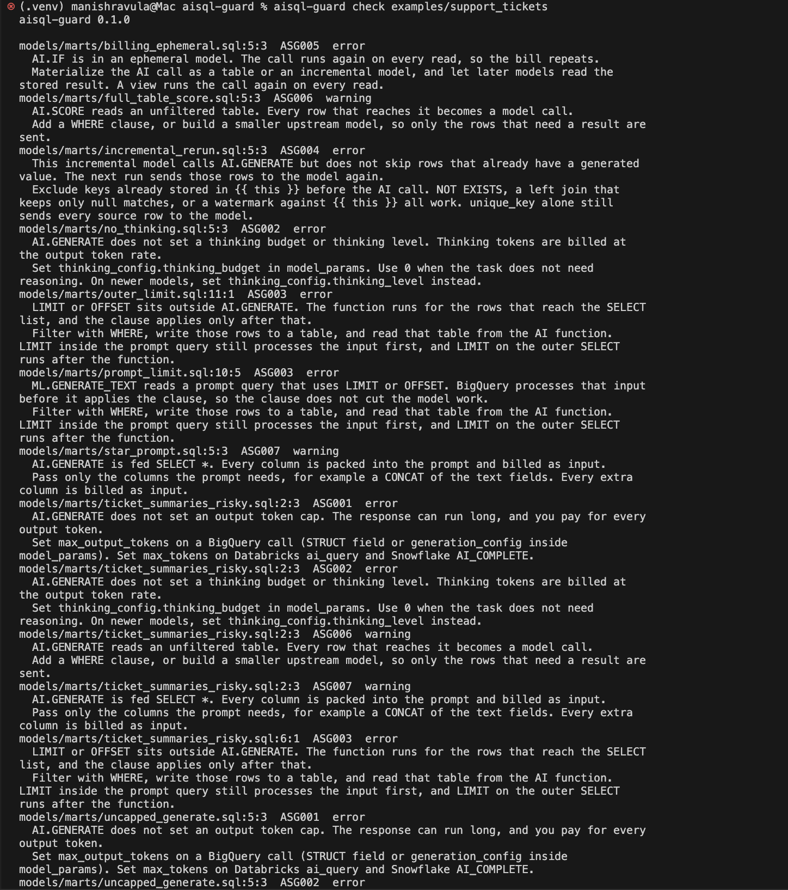
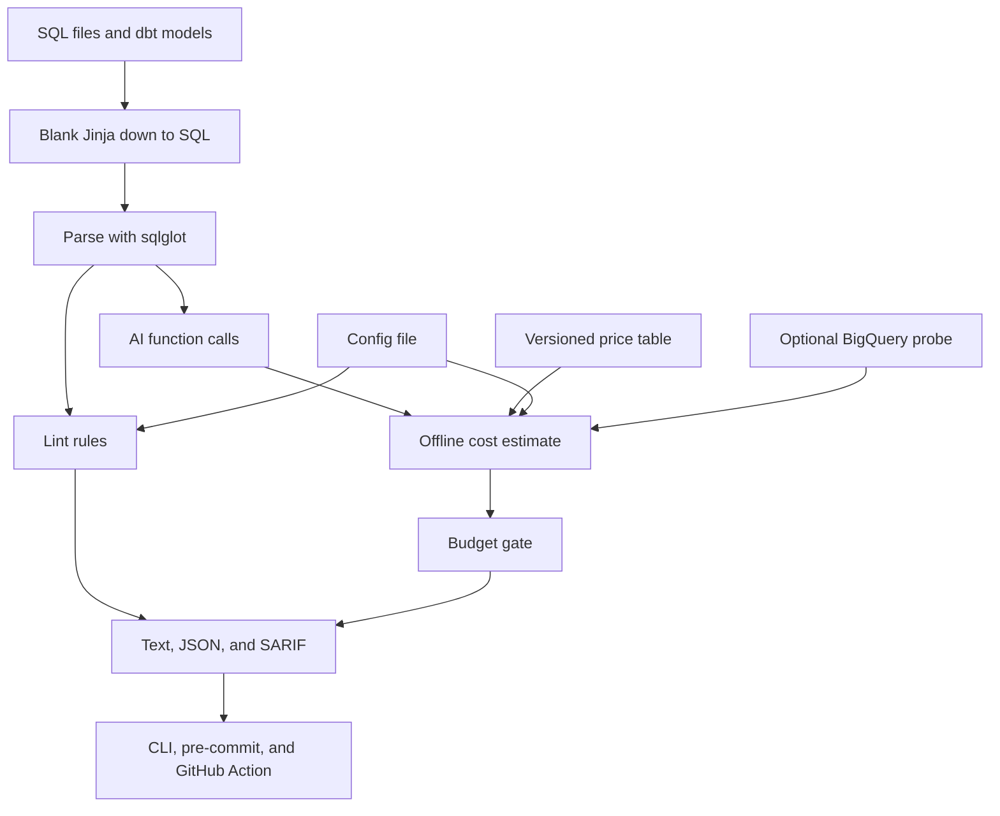
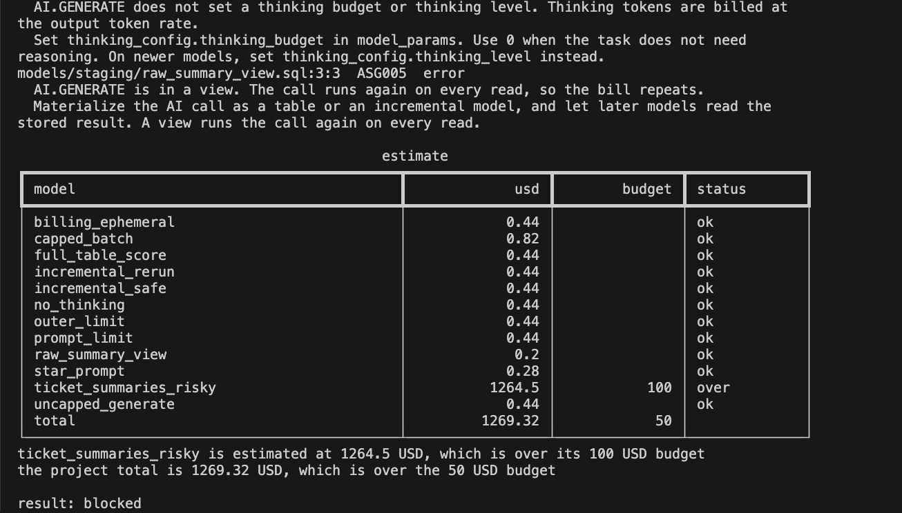
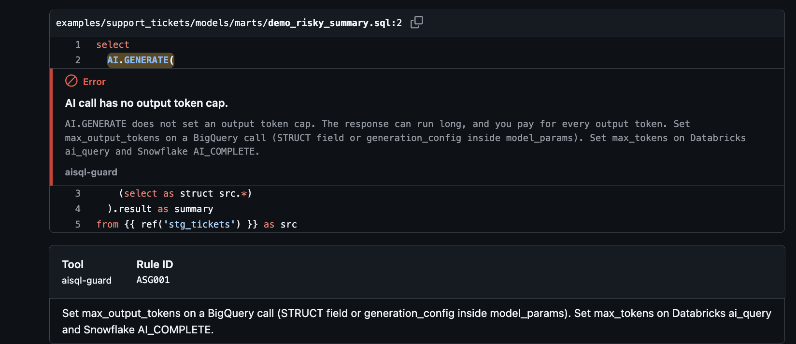
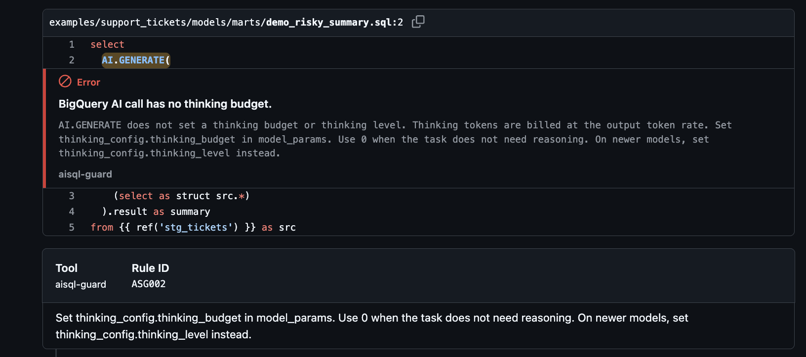
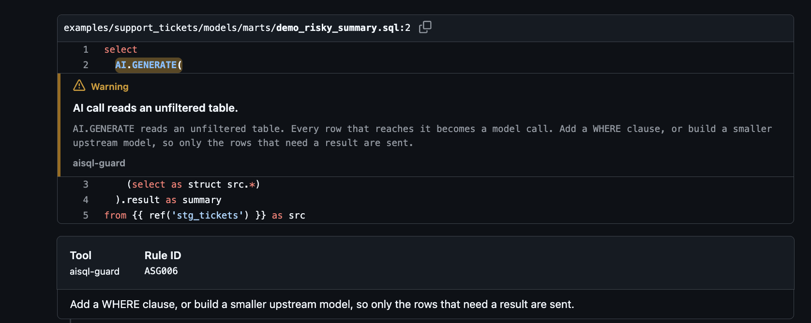
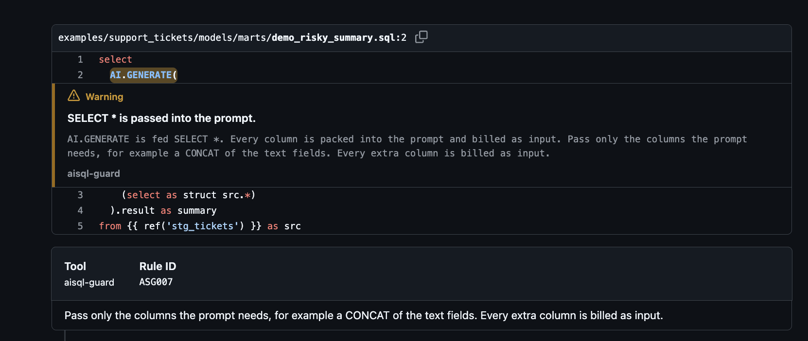
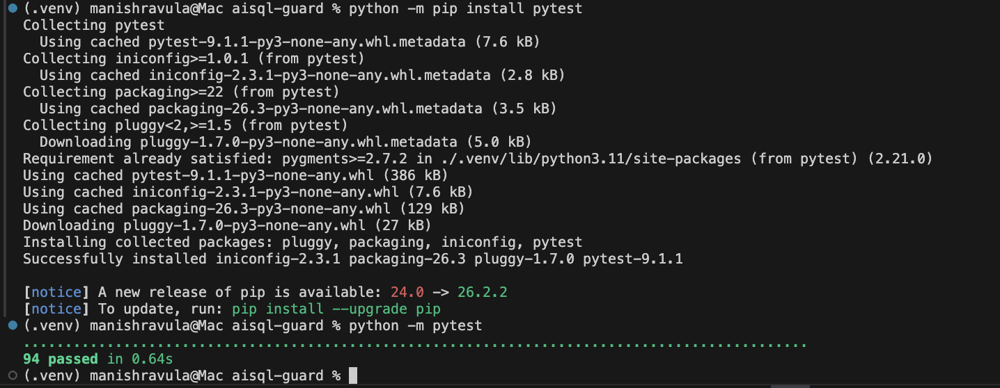

# aisql-guard

Catch surprise costs from AI functions in SQL before the query runs.

`AI.GENERATE`, `ML.GENERATE_TEXT`, `AI.IF`, and the same kind of function in Databricks (`ai_query`) and Snowflake Cortex call a model once per row. Thinking tokens are billed at the output rate. A dbt view runs the call again on every read. An incremental model that does not skip rows already generated pays for those rows again.

Google's [guide to controlling generative AI costs](https://docs.cloud.google.com/bigquery/docs/control-genai-costs) and the [October 2026 post on BigQuery cost management](https://cloud.google.com/blog/products/data-analytics/using-bigquerys-generative-ai-cost-management-features) describe quotas that stop a job after tokens have been used. They do not show the cost while the model is still being edited. [`AI.COUNT_TOKENS`](https://docs.cloud.google.com/bigquery/docs/reference/standard-sql/bigqueryml-syntax-ai-count-tokens) counts input only. Output tokens and thinking tokens are left out, and the function does not charge Vertex AI.

The [`ML.GENERATE_TEXT` reference](https://docs.cloud.google.com/bigquery/docs/reference/standard-sql/bigqueryml-syntax-generate-text) says not to put `LIMIT` or `OFFSET` in the prompt query. The query processes all of the input first, and then applies the clause. A limit on the outer `SELECT` is also too late, because it runs after the select list.

A public note about an `AI.IF` call on 2,225 rows reported thought tokens more than 10 times the output tokens: [Katie Kaczmarek on LinkedIn](https://www.linkedin.com/posts/katiekaczmarek_ai-bigquery-google-activity-7513138530240454656-qyTZ).

aisql-guard reads the SQL first. It lints the risky shapes, estimates the cost from a price table and your own row counts, and exits with a failure status when a budget is crossed.

## Install

The package is not published to a public index. Install it from a checkout:

```bash
python -m pip install .
```

The commands below use the sample dbt project in this repo.

## Quick start

```bash
aisql-guard check examples/support_tickets
```

`check` lints every model and estimates the cost. The sample project is supposed to fail. `ticket_summaries_risky` is over its model budget, and the project is over the total budget, so the status is 1.



The first screen of that check.

`scan` only lints. `estimate` only prices. Add a format when you want a file:

```bash
aisql-guard check examples/support_tickets --format sarif --output aisql-guard.sarif
```

`text` is the default. `json` is the same data for a script. Status 2 means the arguments or the config could not be used.

## How it fits together



Jinja that the linter understands (`ref`, `source`, `this`, `config`, and `is_incremental`) is turned into SQL of the same length, so line numbers still match the file. Other Jinja is blanked. The SQL is then parsed with sqlglot. BigQuery is the default dialect. Databricks and Snowflake are tried when the configured dialect cannot parse the file.

## Rules

| ID | Severity | What it catches |
| --- | --- | --- |
| ASG000 | warning | The SQL could not be parsed, so the structural checks were skipped. |
| ASG001 | error | An open ended call has no output token cap. |
| ASG002 | error | A BigQuery call has no thinking budget or thinking level. |
| ASG003 | error | `LIMIT` or `OFFSET` does not reduce the rows sent to the model. |
| ASG004 | error | An incremental model does not skip rows that were already generated. |
| ASG005 | error | The call is in a view or an ephemeral model, so it runs again on every read. |
| ASG006 | warning | The call reads a table with no filter. |
| ASG007 | warning | `SELECT *` is packed into the prompt. |
| ASG100 | error | The estimate is over a model budget or the project budget. |

Each finding has a fix hint. `unique_key` on an incremental model does not count as a skip. The SQL has to exclude rows already stored on `this`, for example with `NOT EXISTS` or an anti join.

Bool, int, and score style calls do not need an output cap. They still need a thinking budget on BigQuery, because those tokens are billed with the output.

## Config

Put `aisql-guard.toml` in the project, or use a `[tool.aisql-guard]` table in `pyproject.toml`. The toml file wins when both exist. The sample is [`examples/support_tickets/aisql-guard.toml`](examples/support_tickets/aisql-guard.toml).

```toml
dialect = "bigquery"

[rules]
fail_on = "error"
disable = []

[estimate]
default_model = "google-3.5-flash-lite"
default_rows = 1000
default_input_tokens = 400
default_output_tokens = 128
default_thinking_tokens = 0

[estimate.models.ticket_summaries_risky]
rows = 50000
input_tokens = 1500
output_tokens = 512
thinking_tokens = 2048
model = "google-3.5-flash"

[budgets]
total_usd = "50"

[budgets.models]
ticket_summaries_risky = "100"
```

A numeric `max_output_tokens` or `thinking_budget` in the SQL replaces the matching assumption. `thinking_budget = 0` means the estimate includes no thinking cost. A thinking level with no number keeps the assumption.

If the SQL names a priced model, that price is used. A remote model path that is not in the table falls through to the model id in config, then to `default_model`. A call that still has no price is left unpriced. It is not treated as zero. A budget blocks only when the known dollars are over the configured amount.



The end of the same check. The risky model and the project total are over budget, so the result is blocked.

The price table is [`src/aisql_guard/data/pricing.json`](src/aisql_guard/data/pricing.json). Rates were copied on 20 October 2026:

- [Google Cloud generative AI pricing](https://cloud.google.com/vertex-ai/generative-ai/pricing). Global standard rates, context at or under 200K tokens. The output row is text output, response and reasoning, so thinking uses the output rate. The 3.8 Flash row is the introductory rate through 31 December 2026. From 1 January 2027 the page lists a higher rate. This file does not switch on its own.
- [Snowflake Service Consumption Table](https://www.snowflake.com/legal-files/CreditConsumptionTable.pdf), effective 15 October 2026. Table 6(a) is AI credits per million tokens. The default credit price is the global on demand rate of 2.00 USD from table 2(b). Set `snowflake_ai_credit_usd` to `2.20` for the regional on demand price.
- [Databricks foundation model serving](https://www.databricks.com/product/pricing/foundation-model-serving). Rates are DBU per million tokens. The default is 0.07 USD per DBU, the worked example for AWS US East (N. Virginia). Set `databricks_usd_per_dbu` for another SKU. The DBU figures are stored as published, including 7.143, and are not rounded to a marketing dollar amount.

When a BigQuery call omits the endpoint, the estimate uses `google-3.5-flash-lite`, which matches the recent stable Flash-Lite default documented for that function.

## CI

The action installs this repo. It does not install a release from a package index. Live sampling stays off unless you set the live input to `true`.

```yaml
name: aisql-guard
on:
  pull_request:
jobs:
  guard:
    runs-on: ubuntu-latest
    permissions:
      contents: read
      security-events: write
    steps:
      - uses: actions/checkout@v4
      - uses: actions/setup-python@v5
        with:
          python-version: "3.12"
      - uses: manishreddy998/aisql-guard@main
        with:
          command: check
          paths: models
          format: sarif
          output: aisql-guard.sarif
      - uses: github/codeql-action/upload-sarif@v3
        with:
          sarif_file: aisql-guard.sarif
```

Inside this repo the action path is `./`.

pre-commit, from a checkout that already installed the package:

```yaml
repos:
  - repo: https://github.com/manishreddy998/aisql-guard
    rev: main
    hooks:
      - id: aisql-guard
```

The hook runs `check` on staged SQL files.

This repo's own CI lints, type checks, and tests on Python 3.10, 3.11, 3.12, and 3.13. It does not publish the package.

## What a blocked run looks like

The same check also writes SARIF for code scanning.



GitHub code scanning annotations on [pull request 10](https://github.com/manishreddy998/aisql-guard/pull/10).

<details>
<summary>ASG002, ASG006, and ASG007</summary>







</details>

The SARIF document is [`docs/support-tickets.sarif`](docs/support-tickets.sarif).

## Live mode

Live mode is off unless you ask for it. A config file cannot turn it on. It needs the optional extra, and it talks to BigQuery only:

```bash
python -m pip install '.[live]'
aisql-guard estimate examples/support_tickets --live
```

The probe dry runs the SQL you configure and runs `AI.COUNT_TOKENS` on a sample. The sample limit sits inside the aggregate, so the average is not computed over the whole table. Dry run bytes are reported as a note. They are query compute, billed separately, and they are not turned into dollars. Output tokens and thinking tokens still come from the SQL caps or from the assumptions. Tests never construct a real client.

```toml
[live]
project = "billing-lab"
location = "US"
sample_rows = 20

[live.models.ticket_summaries_risky]
prompt = "body"
source = "`warehouse.tickets`"
where = "status = 'open'"
dry_run_sql = "select body from `warehouse.tickets` where status = 'open'"
```

You can set `count_tokens_sql` instead of `prompt` and `source` when the sample query is easier to write by hand.

## Limitations

- Row counts come from config. The tool does not read the warehouse unless live mode is on, and live mode is BigQuery only.
- `AI.COUNT_TOKENS` is input only. Output and thinking stay on the assumption, or on a numeric cap written in the SQL.
- Dry run bytes are not priced.
- Prices are the published figures as read on 20 October 2026. Check the source pages before you trust an old checkout.
- Embeddings, forecasts, and similarity functions are out of scope. They are billed differently.
- Jinja other than `ref`, `source`, `this`, `config`, and `is_incremental` is removed before parsing. A file that still cannot be parsed produces ASG000 and skips the structural checks.
- A dbt model with no materialization is treated as a view, which is the dbt default. An AI call in that model is ASG005.
- The estimate is a planning figure. It is not an invoice.

## Development

From a checkout:

```bash
python -m pip install -e '.[dev]'
python -m pytest
```



`python -m pytest` on this repo. 94 passed.

## License

MIT. Copyright 2026 Manish Reddy.
